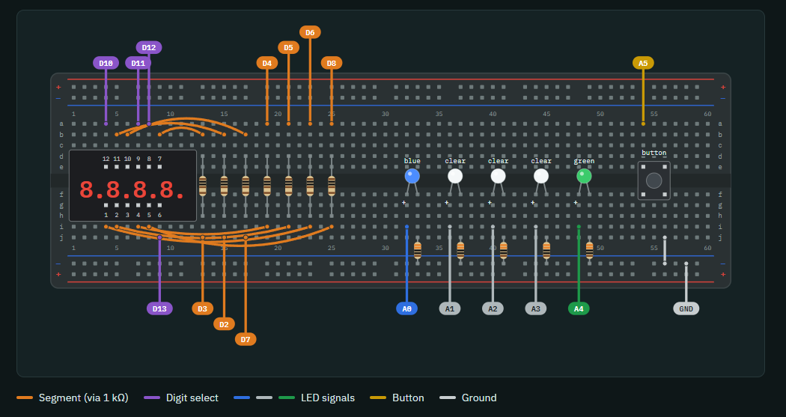

# Drag Racing Tree Light: Reaction Timer

A drag-racing-style light tree on an Arduino Uno. Three clear lights count down, then green comes on after a random 1–3 s pause. Hit the button and a 4-digit display shows your reaction time in milliseconds.

## How it plays

1. Blue is lit and the display scrolls "rEAction trEE tiMEr … PrESS to StArt". Press the button to begin.
2. The three clear lights come on one at a time.
3. After a random pause, green lights. Press as fast as you can.
4. Your time shows on the display, and it flashes if you beat your best. Press again to return to the start.

Pressing before green is a false start: blue flashes and `Err` shows.

## Parts

| Qty | Part | Notes |
|---|---|---|
| 1 | Arduino Uno | |
| 1 | 830-hole breadboard | |
| 1 | KYX-3461BS 4-digit 7-segment display | 12 pins, common anode |
| 7 | 1 kΩ resistors | display segments |
| 5 | 330 Ω resistors | LEDs |
| 5 | LEDs | 1 blue, 3 clear, 1 green |
| 1 | 4-leg tactile push button | uses the Uno's internal pull-up |
| ~26 | Male-to-male jumper wires | |

## Breadboard layout

Holes are named column + row, so `15b` is column 15, row b. Tags at the end of each wire give the Uno pin it connects to.

## Pin map

| Signal | Display pin | Uno pin |
|---|---|---|
| Segments A–G | 11, 7, 4, 2, 1, 10, 5 | D2–D8 (each through 1 kΩ) |
| Digits 1–4 (left → right) | 12, 9, 8, 6 | D10–D13 (no resistor) |
| Decimal point | 3 | not connected |
| Blue / Clear 1–3 / Green LEDs | | A0 / A1–A3 / A4 (each through 330 Ω to GND) |
| Button | | A5 (other leg to GND) |
| Ground rail | | GND |

D0, D1 and D9 are unused.

**Display pinout:** with the digits upright and decimal points along the bottom, pin 1 is bottom-left. Pins run 1–6 left to right along the bottom, then 7–12 right to left along the top.

## Build order

Keep the Uno unplugged until the last step.

1. **Display:** seat it across the center gap in columns 4–9, decimal points toward rows f–j (pin 1 in column 4, bottom side).
2. **Segment resistors:** seven 1 kΩ resistors across the gap (row d to row h) in columns 13, 15, 17, 19, 21, 23, 25.
3. **Display to resistors:** top side `9b→13b`, `5b→15b`, `6b→17b`; bottom side `7i→19i`, `5i→21i`, `4i→23i`, `8i→25i`.
4. **LEDs:** row f, long leg on the left: blue 32/33, clear 36/37, 40/41, 44/45, green 48/49. Add a 330 Ω resistor from each short-leg column (row j) to the bottom − rail.
5. **Button:** straddle the gap in columns 54 and 56. Wire diagonal corners: `54a` to A5, `56j` to the − rail.
6. **Ground:** bottom − rail to an Uno GND pin.
7. **Uno wiring:** run the remaining wires per the pin map and layout image.
8. **Upload:** open [main.ino](main.ino) in the Arduino IDE, select **Tools → Board → Arduino Uno** and your port, then upload. No libraries required.

## Tuning

Constants near the top of [main.ino](main.ino):

- `STEP_MS`, `WAIT_MIN_MS`, `WAIT_MAX_MS`: countdown rhythm and random pause before green
- `MSG_TITLE`, `MSG_PRESS`, `SCROLL_MS`: scrolling message text and speed
- `COMMON_ANODE`: set to `false` for a common-cathode display

## Troubleshooting

| Symptom | Fix |
|---|---|
| Display blank or scrambled | Display may be common cathode. Set `COMMON_ANODE = false`. |
| One segment dark on every digit | Check that segment's jumper and resistor. The resistor must cross the center gap. |
| One whole digit dark | Check its digit wire. Digit 4 leaves from the bottom side (`9j`). |
| LED won't light | It's backwards. The long leg goes on the left, toward the Uno wire. |
| Every press is a false start, or no response | Button is wired on two always-connected legs. Use diagonal corners. |
| Uno's "L" LED flickers | Normal. It shares D13 with digit 4. |
| Display looks dim | Expected. You can drop segment resistors to 470 Ω, but no lower. |
